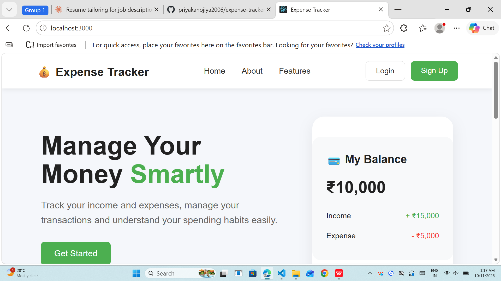
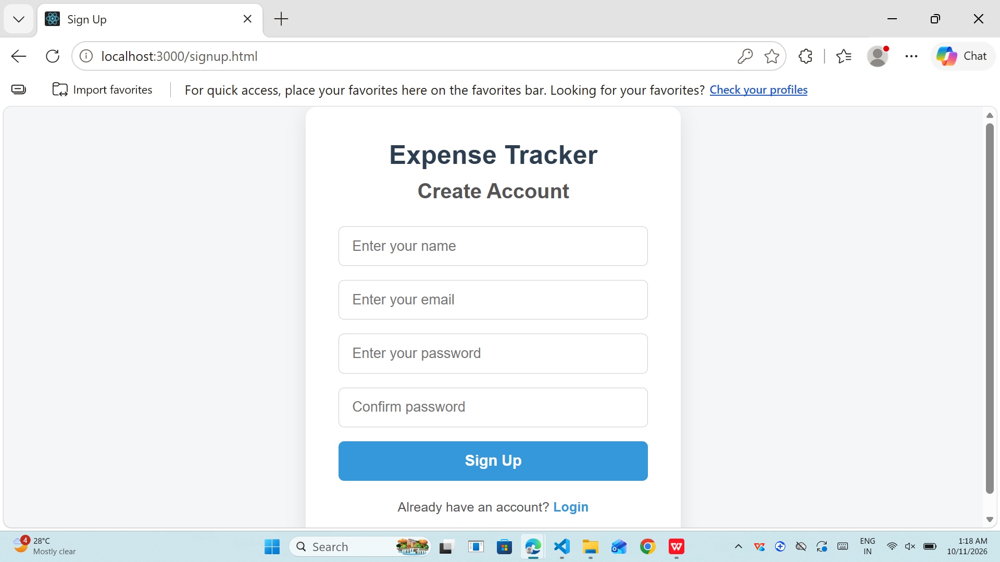
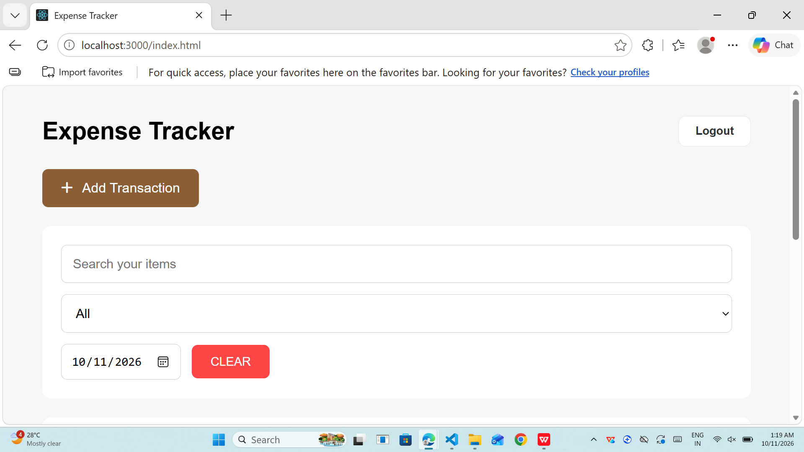
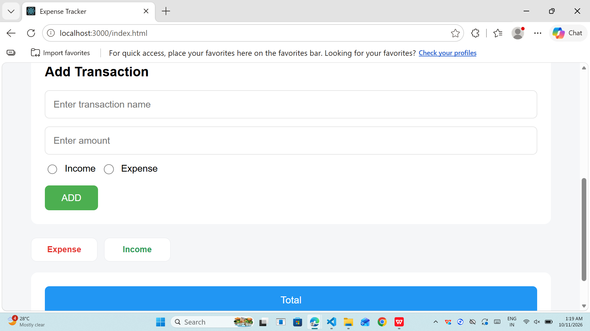

# 💰 Expense Tracker

**A responsive full-stack web app to track income and expenses, with secure user accounts.**


[Live Demo](#) · [Report a Bug](https://github.com/priyakanojiya2006/expense-tracker/issues) · [Features](#features)


## Table of Contents

- [About the Project](#about-the-project)
- [Screenshots](#screenshots)
- [Features](#features)
- [Tech Stack](#tech-stack)
- [Getting Started](#getting-started)
- [Project Structure](#project-structure)
- [API Endpoints](#api-endpoints)
- [How It Works](#how-it-works)
- [Testing and Compatibility](#testing-and-compatibility)
- [What I Learned](#what-i-learned)
- [Limitations](#limitations)
- [Future Improvements](#future-improvements)
- [Author](#author)

## About the Project

Expense Tracker helps users record their income and expenses and understand their spending habits. Visitors start on a landing page, create an account, log in, and then manage their own transactions.

Authentication runs on a **Node.js and Express server**, and passwords are hashed with **bcrypt** before they are stored. The interface is built with **HTML, CSS, and JavaScript** and is responsive across mobile, tablet, and desktop screens.

## Screenshots

<p align="center">
  
  
</p>
<p align="center">
  
  
</p>

## Features

**Account and security**
- Landing page with a Get Started button that leads to sign up
- Sign up and login through a Node.js and Express API
- Passwords hashed with bcrypt before they are stored
- Duplicate email check and required-field validation on the server
- Password match check and clear error messages on the sign-up form
- Logout functionality

**Transaction management**
- Add transactions with a name, amount, and type (income or expense)
- Edit and delete transactions
- Search transactions by name
- Filter transactions with a dropdown and by date
- Clear button to reset filters
- Income, expense, and total summary
- Each user sees only their own transactions

**Interface**
- Responsive layout for mobile, tablet, and desktop screens
- Clean, user-friendly design with a navigation bar and feature sections

## Tech Stack

- **HTML5:** page structure and forms
- **CSS3:** styling and responsive design
- **JavaScript (ES6+):** application logic, DOM manipulation, `fetch` API calls, and event handling
- **Node.js:** server runtime
- **Express.js:** routing, JSON handling, and static file serving
- **bcryptjs:** password hashing
- **LocalStorage:** storing transaction data and the logged-in user in the browser

## Getting Started

**Requirements:** [Node.js](https://nodejs.org) installed on your machine.

1. Clone the repository:
   ```bash
   git clone https://github.com/priyakanojiya2006/expense-tracker.git
   cd expense-tracker
   ```
2. Install dependencies:
   ```bash
   npm install
   ```
3. Start the server:
   ```bash
   node server.js
   ```
4. Open `http://localhost:3000` in your browser.
5. Click **Get Started**, create an account, and log in.
6. Add, edit, delete, search, and filter your transactions.

## Project Structure

```text
expense-tracker/
│
├── server.js            # Node.js and Express server with the auth API
├── package.json         # Project dependencies and metadata
├── .gitignore           # Files excluded from Git
├── README.md            # Project documentation
│
├── screenshots/         # Images used in this README
│
├── data/
│   └── users.json       # Registered users (created automatically, not committed)
│
└── public/              # Frontend files served by Express
    ├── index.html      # Home page (opens at "/")
    ├── Features.html    # Features page
    ├── Dashboard.html   # Dashboard page
    ├── signup.html      # Create account page
    ├── login.html       # Login page
    ├── expe.html       # Main expense tracker page
    ├── auth.js          # Sign up and login (calls the API)
    ├── expe.js          # Expense tracker functionality
    └── *.css            # Page styles
```

## API Endpoints

- `POST /api/signup`: creates a new user. Expects `name`, `email`, and `password`. Returns `201` on success, `400` if a field is missing, and `409` if the email is already registered.
- `POST /api/login`: checks the email and password against the stored hash. Returns the user's name and email, or `401` for invalid credentials.

## How It Works

- The home page opens first at `http://localhost:3000/`.
- Get Started opens the sign-up page, and users can switch between sign up and login.
- `auth.js` sends the form data to the API using `fetch`.
- The server hashes the password with bcrypt on sign up, and compares the hash on login.
- After a successful login, the user is redirected to the main expense tracker page.
- Transactions are saved in browser LocalStorage under a key based on the user's email.

## Testing and Compatibility

- Tested on multiple screen sizes (mobile, tablet, and desktop).
- Tested in multiple browsers.
- Tested sign up and login flows: new account, duplicate email, wrong password, and mismatched passwords.
- Debugged issues with browser DevTools and the terminal.

## What I Learned

- Building a REST-style API with Node.js and Express
- Hashing and verifying passwords with bcrypt
- Connecting a frontend to a backend with the `fetch` API
- Handling HTTP status codes and error messages
- DOM manipulation, forms, and form validation
- CRUD operations and LocalStorage
- Responsive web design
- Debugging with browser DevTools
- Using Git and GitHub, and documenting a project clearly

## Limitations

- Users are stored in a JSON file, not a database.
- There are no sessions or tokens, so the logged-in state is kept in the browser.
- Transactions are stored in browser LocalStorage, so they are tied to one browser.
- Built for learning and portfolio purposes, not for production use.

## Future Improvements

- Move users and transactions to a database such as MongoDB
- Add JWT-based sessions and protected API routes
- Add expense categories, monthly filtering, and budget tracking
- Add charts and analytics
- Improve the mobile interface

## Author

**Priya Kanojiya**
B.Sc. Information Technology Student, Sophia College, Mumbai

[GitHub](https://github.com/priyakanojiya2006) · [LinkedIn](#) · [Portfolio](#)
